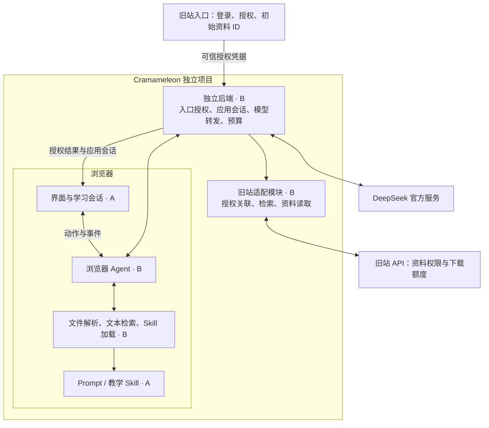

# Cramameleon：项目架构与模块契约

版本：v1.4 · 2026-11-04 · 面向开发者 A / B

本文为当前唯一开发约定，整合并替代此前的架构、A/B 分工、决策和 TODO 文档。旧稿归档，仅作历史参考；原始 Idea 与需求稿保留为背景资料，冲突以本文为准。本文只对齐模块职责、交互契约与关键行为，不规定逐步实现。

## 1. 项目定位与入口

**Cramameleon 保留独立项目、独立前后端、独立构建与运行结构；当前只允许用户通过旧站入口授权后进入。**

- 不提供独立注册、独立登录或无需授权即可使用的公开入口。
- 旧站负责确认登录身份并签发进入授权；Cramameleon 验证授权与内部开发者资格后，建立自己的应用会话。
- 用户无有效应用会话时，直接访问只显示返回旧站的入口，不开放学习功能或业务 API；已授权会话内允许刷新和恢复。
- 入口可以携带资料或课程包 ID 作为初始学习上下文；资源 ID 不等于读取授权，仍须核对权限。
- 独立结构不要求发布独立入口。具体域名、挂载路径和内部端口属于部署配置，不与模块逻辑绑定。

## 2. 宏观架构



教学运行循环在浏览器。新后端负责授权和受控接入，不执行后台教学 Agent。旧站对外提供授权与资料接口；Cramameleon 不直接读取旧站数据库或资料磁盘。

### 技术方案

沿用旧站的 React + Vite、Go + Gin、SQLite 技术路线；新前端按此前约定使用 TypeScript，数据库独立于旧站。SQLite 只保存本应用会话授权、身份映射与用量等服务端数据，聊天与资料文本继续保存在本机。

首版采用 Pi Agent Core（`@earendil-works/pi-agent-core`）作为浏览器 Agent 内核，外层由 B 编写 Cramameleon 业务适配层，负责白名单工具、业务校验、上下文、运行上限和事件转换。UI 与模拟实现通过自己的契约连接，不依赖 Pi 的内部数据结构；不引入 Pi Coding Agent CLI 或 Node.js 服务端 Agent。具体版本在浏览器构建与代理流验证后锁定。

模型流通过自定义 `streamFn` 连接 Go 代理。Pi 的工具事件转换成项目业务事件，Go 不需要运行 Pi。文件解析等基础能力使用合适的库，React/Vite 与 Go/Gin 的技术路线保持不变。

模型返回工具名和参数后，由浏览器 Agent 执行工具并把结果提交给下一次模型请求。新 Go 后端只校验和转发单次模型请求，不负责决定下一步教学或启动第二次模型调用。

## 3. 模块与责任边界

服务器项目根目录：`/home/ubuntu/cramameleon`。目录结构保持已创建的方案。

| 模块 | 负责人 | 向外承诺的职责 |
|---|---|---|
| 前端工程、`src/ui` | A | 界面、入口授权状态、聊天、题板、资料选择、来源与错误展示；消费统一契约 |
| `src/session` | A | 本机保存和恢复消息、作答、资料文本、偏好与进度；按用户隔离；不管理跨站认证 |
| `prompts`、`skills` | A | router/style 与 concept/review/exam 教学内容；明确输出与用户改口规则 |
| `src/contracts` | B 起草维护，A 确认 | 公共类型、动作、事件、状态、错误、题目和来源；保持界面事件与模型协议一致 |
| `src/agent` | B | 浏览器运行循环、上下文、工具调度、取消、结果校验；维护可注入模型响应的真实 Agent 测试 |
| `src/tools` | B | 解析与文本分块、范围内检索、白名单 Skill 加载、统一资料源接口 |
| `server` | B | 验证旧站入口授权、建立应用会话、开发者准入、模型转发、全局预算和并发 |
| 旧站接入与必要改动 | B | 旧站入口授权与资料接口适配；维护身份映射、资源权限、计次与部署边界 |

A 不在组件内另写模型/工具循环；B 不接管产品界面和教学文案。旧站特有的账号字段、路由和存储细节封装在适配模块中，不进入 Agent 的通用逻辑。

## 4. 模块间契约

下表描述必须对齐的语义。具体字段由 B 收敛到 `src/contracts`，A 用统一业务事件与可控模型响应验证；接口变化同步更新类型和模拟数据。

| 边界 | 输入 | 输出与约束 |
|---|---|---|
| 旧站 → Cramameleon 后端 | 可验证的进入授权、用户身份、可选资源 ID | 授权结果、内部用户标识、应用会话、初始上下文；不信任普通 URL 参数中的身份或权限 |
| 界面 → Agent | 用户动作、学习会话/轮次 ID、历史、已选资料、偏好/进度、取消信号 | 同一轮事件流；发送、资料确认、下一题、继续和失败重试均有明确动作 |
| Agent → 界面 | 文字、工具状态、资料候选、解析结果、来源、题目、状态更新、错误和结束事件 | 事件绑定学习会话和轮次；终止后不再提交结果，迟到事件不能污染新轮 |
| 界面 / Agent → 文件工具 | 本地文件或受保护的资料字节、格式、任务归属、取消信号 | 文档、文本块、真实来源位置和解析警告；独立导入不触发模型调用 |
| Agent → Skill / 文本检索 | 白名单 Skill 名，或当前已选文档范围与问题 | 带版本的 Skill，或必要文本片段；材料内容不能扩展指令和工具权限 |
| 浏览器 → 新后端 | 有效应用会话、模型请求或资料操作 | 受控模型流、统一资料结果或结构化错误；密钥与旧站访问凭据不进入前端和模型上下文 |
| 新后端适配器 → 旧站 | 绑定用户的资料授权、受限资源 ID、分页等参数 | 搜索、目录、文件或权限/额度错误；沿用旧站权限，不接受任意 URL 或磁盘路径 |
| 界面 → 本机存储 | 已确认消息、题目/作答、文本块、资料范围和学习状态 | 恢复结果或明确保存失败；删除后不因迟到写入重新出现 |

公共数据至少统一以下语义：**用户、应用会话、学习会话、轮次、文档/块、资料引用、题目/作答、学习状态、错误与终态**。身份与授权凭据不混入学习数据。`src/contracts` 统一 JSON 字段、结构校验和样例；后端 Go DTO 对齐同一结构，避免两端各自定义一套协议。

### 三层数据交互

| 层次 | 通信方式 | 统一数据 |
|---|---|---|
| React UI ↔ 浏览器 Agent | 本地 TypeScript 调用与异步事件流 | `AgentInput`：动作、学习会话/轮次、有效历史、选中资料、偏好/进度与本地取消信号；`AgentEvent`：文字、候选、题目、来源、状态、错误与结束 |
| 浏览器 Agent ↔ 新 Go 后端 | 模型用 POST + 流式响应；资料与会话用普通 HTTP API | 模型请求携带 requestId、turnId、messages、允许的工具；响应是文本/工具参数片段、用量和单次模型终态。AbortSignal 留在浏览器，不放进 JSON |
| 新后端 ↔ 旧站 | 服务端授权 API、资料 JSON 和受限文件字节流 | 用户绑定的受限资料凭据、资源 ID、分页、读取授权；原始旧站响应由适配器转换，不直接暴露给 UI 或模型 |

模型流建议采用 SSE 格式，通过 POST fetch 的响应流读取，避免将原生 EventSource 的自动重连用于会产生费用的模型调用。前端取消传递到 Go 请求上下文，再取消上游；Worker 任务单独取消。

对 UI 的业务事件至少覆盖 `text_delta`、`tool_status`、`materials_ready`、`document_ready`、`quiz_ready`、`sources_ready`、`state_update`、`error`、`done`。测试通过真实 PiAgentAdapter 验证相同事件。单次模型的 finish 不等于 Agent 的 done；一个 turn 可以包含多个独立 requestId，直到 Agent 真正完成、取消、失败、达到上限或等待用户选择。

工具参数增量必须先在 Agent 内拼成完整调用并校验，再执行；部分 JSON 不执行。UI 只消费业务事件，不直接消费供应商协议或工具参数片段。

题目通过独立结构化载荷返回，不从聊天文字提取；完整校验后才发 quiz_ready。JSON 格式正确不等于题目、来源和选项关系正确，仍需业务校验。作答留在本地，用户主动继续时才把必要作答信息加入下一轮输入。

## 5. 旧站 API 改造边界

旧站采用增量集成接口，建议统一放在 `/api/integrations/cramameleon/`。以下为模块契约与路由草案，不是已存在的接口；实际路由由 B 核对旧站版本后冻结。

| 接口能力 | 路由草案 | 职责 |
|---|---|---|
| 入口授权 | `POST .../authorize` | 旧站验证自己的已登录用户、目标应用与回调约束，签发短时单次 code，绑定授权范围与初始资料上下文 |
| 服务端兑换 | `POST .../token` | 只由 Cramameleon 后端兑换；核验 code、客户端与授权流程绑定，返回可信身份、有效期和受限资料访问凭据 |
| 搜索、详情、目录 | `GET .../materials`、`.../materials/:id`、`.../packages`、`.../packages/:id/items` | 接受受限集成凭据，复用现有元数据能力；统一资源标识，不返回磁盘路径 |
| 普通资料内容 | `GET .../materials/:id/content` | 按旧站既有单文件权限和下载计次读取；不以公开 preview 替代 |
| 课程包周期授权 | `POST .../packages/:id/access` | 按用户、包、旧下载周期取得可幂等的读取授权；仅首次扣次 |
| 条目内容 | `GET .../packages/:id/items/:itemId/content` | 校验条目归属和已取得的周期授权，仅流式发送该文件，不另扣次、不自动下载整包 |

旧站授权页面继续使用现有登录方式，再调用入口授权能力；Cramameleon 提供对应的授权发起/回调、应用会话、模型与资料适配接口，不提供独立账号密码登录。授权流程使用标准授权码模式的回调校验、state、PKCE 和客户端绑定；长期登录 token 不通过跳转 URL 传递。

集成凭据要有明确的目标应用、权限范围与有效期；不能直接获得旧站全部账户能力。入口准入与资料读取分别校验。现有检索/目录逻辑可复用，授权校验与额度逻辑收敛为共享内部能力，避免新授权和旧下载各扣一次。

新课程包授权的唯一语义为“旧站用户 + 包 + 下载周期”。有本周期授权时，即使剩余次数为零，也可继续读该包的允许条目；并发授权和重试不能重复扣次。普通单文件与原整包下载的政策保持原样。

## 6. 三类会话与授权边界

| 对象 | 职责 | 生命周期边界 |
|---|---|---|
| 学习会话 ChatSession | `src/session` 保存学习记录 | 本机恢复与删除；其 ID 不是登录凭据 |
| 应用会话 AppSession | Cramameleon 后端确认用户已从旧站获准进入 | 只由有效入口授权建立；有效期内可恢复，失效后回旧站重新进入 |
| 资料访问授权 MaterialAccess | 适配器代表用户调用旧站资料接口 | 与进入授权分开核验，过期或额度不足只影响相应资料读取 |

旧站登录状态、Cramameleon 应用会话和学习会话不共享同一个 session ID；不假定 Cookie 或 localStorage 自动跨应用共享。授权应使用短时、可验证且不可重复兑换的凭据，协议字段和有效期由 B 与旧站对齐。自己的应用会话可使用服务端 Session + HttpOnly Cookie，旧站访问凭据保留在新后端。

进入权限不等于所有资料权限，也不等于无上限模型调用权限。Cramameleon 仍执行服务端开发者允许名单、预算与并发控制；不新增独立账号密码入口。

**运行独立性**：新应用可单独构建、启动和部署。旧站不可用时，无法新建入口授权；已持有有效应用会话的用户仍可使用核心问答、本地资料和缓存内容，远程资料能力按可用状态提示。应用会话过期或被撤销后不能绕过入口限制。

开发环境允许内部授权及可控模型响应联调，但正式部署不能用模拟模式绕过旧站入口。真实授权尚未接通时，不把内部模拟演示标成入口链路完成。

## 7. 必须共同遵守的产品契约

| 主题 | 统一行为 |
|---|---|
| 教学 | 简单问题直接解释；明确学习时按需用 Skill，可酌情出题；复习先范围再内容；用户最新要求优先 |
| 偏好与进度 | 偏好默认在会话内持续，明确“本次”的仅本次；保存课程、章节和位置，界面简要展示 |
| 聊天与生命周期 | 支持停止、失败/中断重试、复制、删除与恢复；刷新未完成轮标中断；不做历史编辑、已完成回答重生成或分支 |
| 题板 | 首版单选；答案与所有选项解释一次生成并校验，默认隐藏；作答反馈在本地完成，用户主动继续才请求模型 |
| 资料范围 | 会话内多份资料可勾选；选包后先目录，再由用户选文件；优先已给资料，只读取必要片段 |
| 来源 | 引用能定位缓存文本块及真实页/幻灯片/章节位置；远程资料附原站链接；不编造页码、真题或考试范围 |
| 文件与缓存 | 支持 TXT、Markdown、文本 PDF、DOCX、PPTX 和受限 ZIP；Worker 解析；只保存文本块、来源和元数据，不保存原文件 |
| 运行限制 | 默认每轮 6 次工具调用、2 分钟；修复/重试计入上限；达到上限保留已有结果并结束，无后台自主任务 |
| 文件限制 | 默认单文件 20MB；本地 ZIP 展开最多 100MB、200 条、禁止嵌套压缩包；远程课程包按条目读取 |
| 模型 | DeepSeek 官方服务、统一服务端密钥、可配置模型名；全局预算按输入/输出合计 token 和北京时间自然日，默认全局并发 2、单人 1 |
| 下载计次 | 新条目接口按旧站账号、课程包、下载周期首次扣一次，后续条目/重试不重复扣；原单文件/整包规则不变；本机缓存不扣次 |
| 异常 | 明确区分入口授权/应用会话、资料权限/额度、模型预算/并发、文件解析、网络和存储错误，给出可恢复动作 |

首版不含 OCR、旧 DOC/PPT 转换、跨设备同步、长期画像、错题库、语音、自动学习计划、开放网页搜索等扩展。有效 Quiz 仍包含正确选项和解释；这不要求预先建立教学测试标准答案集。

## 8. 当前实现与后续工作

当前已进入真实模型教学执行阶段，不再保留独立的脚本 Agent 实现。正式界面与自动化测试共同使用 PiAgentAdapter；测试通过注入模型响应控制边界条件，实际工具调度和业务校验仍由同一套 Pi Agent 执行。

```text
React UI → PiAgentAdapter → Pi Core → 自定义 modelStream → Go/Gin → DeepSeek
                              ↕
       教学 Skill / 学习状态 / 已解析文本检索与引用 / 单选题工具
                              ↓
              文字、来源、题目、学习状态和终态 → UI / IndexedDB
```

**已实现（2026-11-04）**：内部口令与持久应用会话、真实 DeepSeek 流式代理、SQLite 全局预算、并发与请求去重；多对话与历史隔离、停止重试和本机恢复；concept/review/exam 教学 Skill、课程/章节/进度与偏好、题目校验及本地反馈；已选且已解析文本的受限检索、已读块引用与原题核对。真实模型教学验收 12 项通过，见 `docs/Agent教学执行验收-2026-11-04.md`。此前教学用例使用可控文本；第 4 部分现已补齐实际 TXT、Markdown、文本 PDF、DOCX、PPTX、ZIP 的 Worker 解析、资料选择、本机缓存与来源定位，并通过真实模型闭环。详见 `docs/本地资料闭环验收-2026-11-04.md`。旧站集成仍未完成。

**下一阶段**：旧站入口授权、开发者身份映射与资料权限/额度适配；继续进行真实课程的教学质量评估。模型输出及学习状态仍需结合资料与人工评价持续改进。

服务器项目位于 `/home/ubuntu/cramameleon`，当前仅监听 `127.0.0.1:18085`，内部通过 SSH 转发访问。旧站授权尚未完成，内部口令不能作为正式旧站入口的替代。运行、限制与错误恢复方式见 `README.md`。

当前内测模型为 `deepseek-flash`，默认每日全局预算为 1,000,000 token，全站累计上限为 100,000,000 token。旧站曾出现源码与部署产物不一致，改动前仍需核对基线；域名/挂载路径、正式授权协议、有效期和准入身份需在旧站接入阶段落实。

技术依据：[Pi Agent Core](https://github.com/earendil-works/pi/blob/main/packages/agent/README.md)、[DeepSeek 工具调用](https://api-docs.deepseek.com/guides/tool_calls/)、[DeepSeek JSON 输出](https://api-docs.deepseek.com/guides/json_mode)、[Fetch 流与取消](https://developer.mozilla.org/en-US/docs/Web/API/Fetch_API/Using_Fetch)、[OAuth 安全最佳实践](https://www.rfc-editor.org/rfc/rfc9700.html)。这些资料支持底层协议能力，不替代本项目实际联调。
